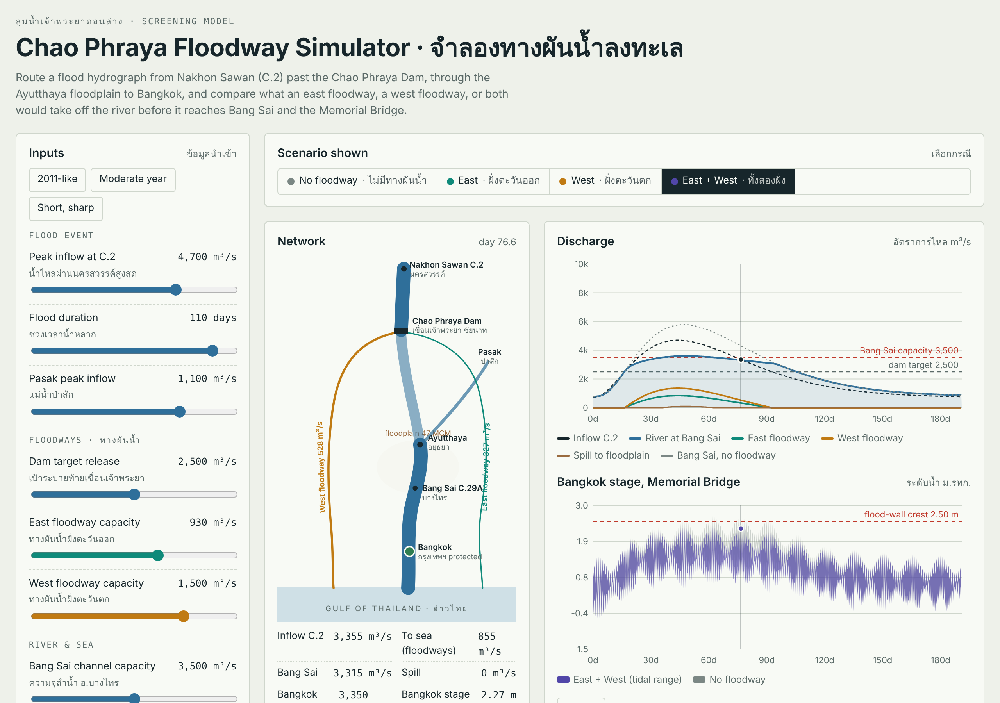
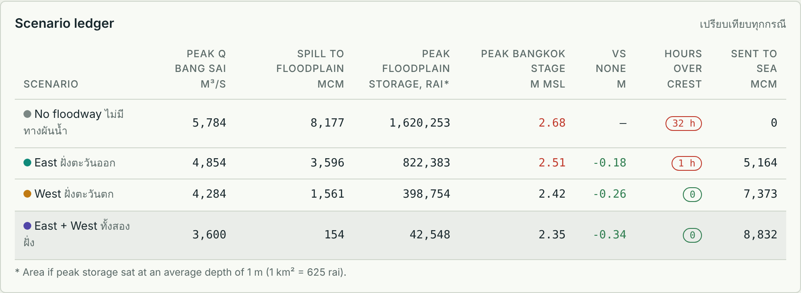
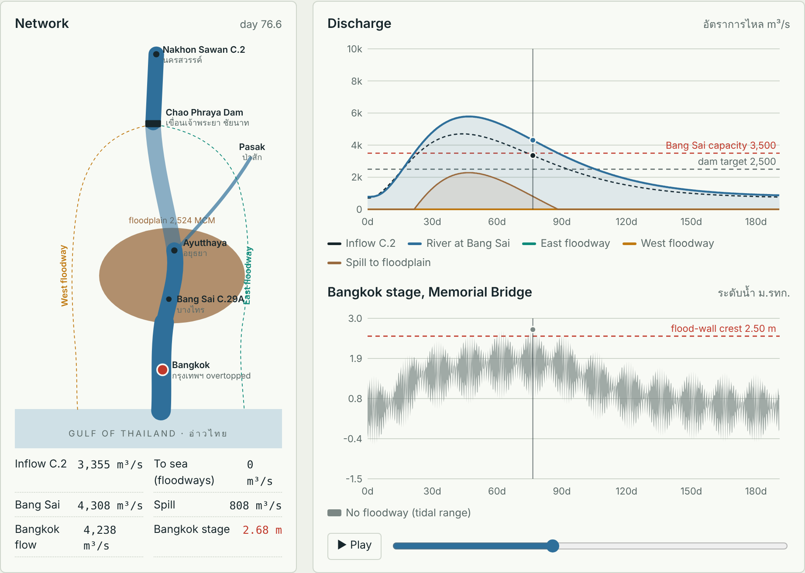
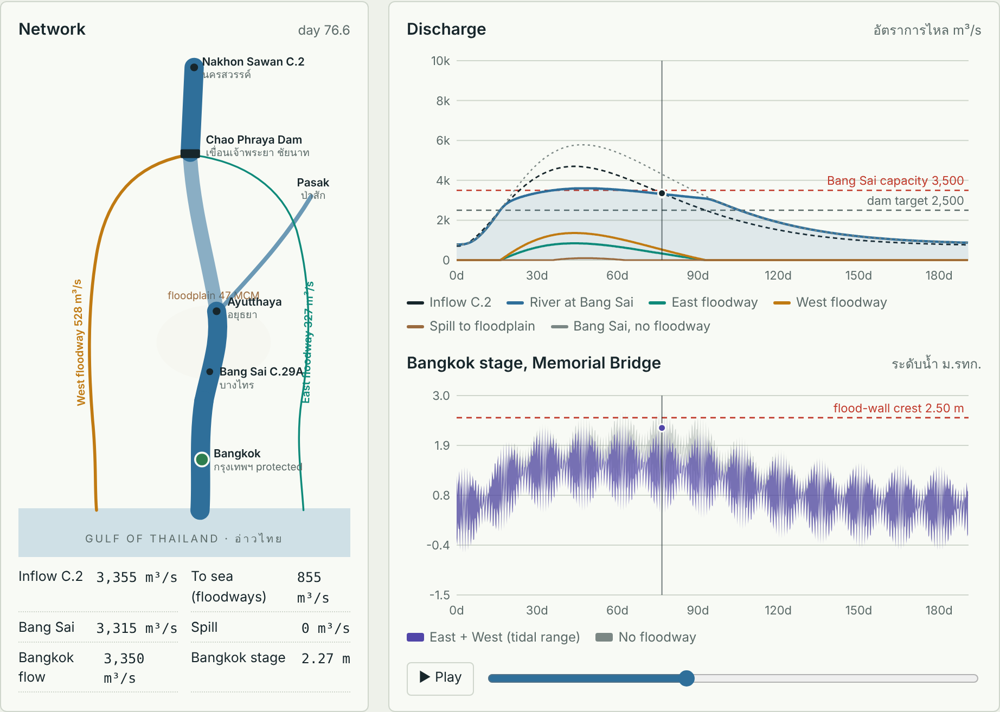

# Chao Phraya Floodway Simulator · จำลองทางผันน้ำลงทะเล

An interactive screening model of the proposed Chao Phraya floodways that would divert flood water to the Gulf of Thailand. It routes a flood from Nakhon Sawan (C.2) past the Chao Phraya Dam and through the Ayutthaya floodplain to Bangkok, and compares four cases side by side: **no floodway, east, west, and both**.

> Note: This repository is a public case study. The source code of the simulator is not included.

## Why

The lower Chao Phraya can carry about 3,500 m³/s at Bang Sai. In a 2011-scale flood, much more arrives from upstream, spills onto the Ayutthaya floodplain, and keeps Bangkok high for weeks. The simulator shows, in a few seconds, how much each floodway option would take off the river and what that means for floodplain spill and the Bangkok flood wall.

## Features

- **Adjustable flood event:** peak inflow at C.2, duration, Pasak inflow, with 2011-like, moderate and short-sharp presets
- **Floodway settings:** dam target release, east capacity (default 930 m³/s, the Cabinet-approved Chai Nat–Pasak–Gulf project) and west capacity (default 1,500 m³/s, a JICA master-plan concept)
- **River and sea:** Bang Sai channel capacity, spring-tide amplitude, sea-level offset, flood-wall crest
- **Animated network schematic** you can scrub through time, with line widths showing flow
- **Charts:** discharge along the system and the tidal stage at Memorial Bridge, Bangkok
- **Scenario ledger:** peak flow, floodplain spill, stored volume, peak Bangkok stage, hours over the flood wall and volume sent to sea for all four cases
- Bilingual Thai / English, works on desktop and phone, light and dark themes

## Example result (2011-like event)

With both floodways, floodplain spill drops by about 98% and Bangkok stays below the 2.5 m flood-wall crest. With no floodway it overtops for about 32 hours.

| No floodway | East + West |
|---|---|
|  |  |

## Method

A lumped hydrologic routing model, built for comparing scenarios rather than predicting exact levels:

1. Gamma-shaped inflow hydrograph at C.2, with the Pasak joining at Ayutthaya
2. Capacity-based diversion at the Chao Phraya Dam, split between floodways in proportion to capacity
3. Linear-reservoir routing (dam → Bang Sai → Bangkok)
4. Floodplain storage for flow above Bang Sai capacity, with slow return flow
5. Bangkok stage from a rating curve plus a synthetic spring–neap tide, tuned to roughly match the 2011 peak

It is not calibrated. The natural next step is the same four-scenario setup in **MIKE HYDRO River / MIKE+** with surveyed cross-sections and observed C.2, C.29A and C.4 records.

## Tech

Single-page web app: vanilla JavaScript, SVG charts and schematic, runs entirely in the browser.

## References

- [Cabinet approves Chai Nat–Pa Sak–Gulf flood diversion canal](https://www.pattayamail.com/news/cabinet-approves-160-billion-baht-chai-nat-flood-diversion-canal-project-566935)
- [JICA Comprehensive Flood Management Plan for the Chao Phraya River Basin](https://openjicareport.jica.go.jp/pdf/12127213_03.pdf)
